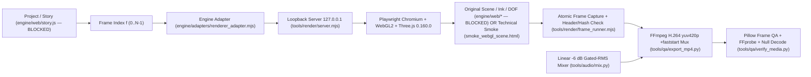

# Architecture & Function-Level Accountability (`SHORT-01`)

## 1. Target Render Pipeline Call Graph

---

## 2. Function-Level Accountability Table

Every significant function implemented in this repository is listed below with its exact file, provenance, contract, side effects, and test coverage. Original kit functions are explicitly recorded in [SOURCE_AUDIT.md](SOURCE_AUDIT.md) as `BLOCKED_MISSING_INPUT` until `cartoon-short-kit.zip` is supplied.

| File & Symbol | Provenance | Arguments | Return / Effect | Frame / Seed Dependency | Side Effects / Disk Writes | Verified By |
| :--- | :---: | :--- | :--- | :--- | :--- | :--- |
| `tools/setup/safe_path.py::resolve_confined` | NEW | `(root, relative_path)` | Resolved `Path` confined inside `root`; raises `PathSecurityError` on escape | None | None | `tests/unit/test_safe_path_and_disk.py` |
| `tools/setup/safe_path.py::safe_rmtree` | NEW | `(target, allowed_parent)` | Deletes strictly nested dir; refuses root/external paths | None | Recursive delete inside `allowed_parent` only | `tests/unit/test_safe_path_and_disk.py` |
| `tools/setup/safe_path.py::atomic_write_bytes` | NEW | `(dest, data)` | Writes sibling temp file + `fsync` + `os.replace` | None | Writes `dest` atomically | `tests/unit/test_safe_path_and_disk.py` |
| `tools/setup/safe_path.py::check_disk_space` | NEW | `(path, estimated_needed_bytes, low_watermark_mb)` | Free-space report dict; raises `DiskSpaceError` below watermark | None | Read-only `disk_usage` | `tests/unit/test_safe_path_and_disk.py` |
| `tools/setup/audit_kit.py::inspect_zip_archive` | NEW | `(zip_path, max_total_bytes, max_file_bytes, max_ratio)` | CRC32/SHA-256/security audit dict; rejects traversal, symlinks, duplicates, bombs, corrupt CRCs | Deterministic per ZIP bytes | Read-only | `tests/unit/test_audit_kit.py` |
| `tools/setup/audit_kit.py::safe_extract_and_preserve` | NEW | `(zip_path, project_root, preserve_dir, license_status)` | Extracts to isolated `workspace/cache/kit-extract-*`, verifies SHA-256 parity, cleans temp | Deterministic per ZIP bytes | Writes preserved copy & deletes isolated temp | `tests/unit/test_audit_kit.py` |
| `tools/setup/safe_setup.mjs::verifyEnvironment` | NEW | `(projectRoot)` | Structured environment readiness report (Node, Three.js 0.160.0, Playwright, Python, FFmpeg, kit presence) | None | Read-only | `tests/run_all.py` (`env_safe_setup_verify`) |
| `app/shared/contract.mjs::validateProjectSpec` | NEW | `(spec)` | Validates 1080×1920 30fps and rejects 16:9 / Skia / ReachMora / AI-video | None | None | `tests/unit/test_contract_and_adapter.mjs` |
| `tools/render/server.mjs::startLoopbackServer` | NEW | `(mounts, port)` | Starts `127.0.0.1` HTTP server with traversal blocking (`403`) | None | Loopback TCP socket | `tests/unit/test_contract_and_adapter.mjs` |
| `tools/render/frame_runner.mjs::checkDiskPreflight` | NEW | `(targetDir, opts)` | Disk free-space report; throws `DiskPreflightError` below reserve | None | Read-only `statfsSync` | `tests/unit/test_contract_and_adapter.mjs` |
| `tools/render/frame_runner.mjs::validateExistingResumeFrame` | NEW | `(filePath, expectedSha256, w, h)` | Validates PNG/JPEG header dimensions + SHA-256 before RESUME skip | Deterministic per file bytes | Read-only | `tests/unit/test_contract_and_adapter.mjs`, `tests/integration/test_webgl_and_ffmpeg.py` |
| `engine/adapters/renderer_adapter.mjs::createRendererAdapter` | NEW | `(projectRoot)` | Exposes `initializeRenderer`, `renderFrame`, `renderFrameRange`, `renderStill`, `getRenderMetadata`, `disposeRenderer` | Deterministic per `frameIndex` | Loopback server, Chromium process, atomic frame files + `resume-manifest.json` | `tests/unit/test_contract_and_adapter.mjs`, `tests/integration/test_webgl_and_ffmpeg.py` |
| `tools/timing/timing_contract.py::expected_frame_count` | NEW | `(duration_seconds, fps=30)` | Returns `round(duration_seconds * fps)` or raises `TimingValidationError` | Deterministic | None | `tests/unit/test_timing_contract.py` |
| `tools/timing/timing_contract.py::validate_segments` | NEW | `(segments, audio_duration_seconds, fps=30)` | Validates monotonic order, pauses, bounds, frame mapping | Deterministic | None | `tests/unit/test_timing_contract.py` |
| `tools/audio/mix.py::compute_gated_rms` | NEW | `(samples, sample_rate, window_ms, gate_dbfs)` | Active-window gated RMS & ungated RMS metrics | Deterministic | None | `tests/unit/test_audio_mix.py` |
| `tools/audio/mix.py::mix_linear_gated_rms` | NEW | `(narration, music, sfx, ...)` | Constant-gain -6.02 dB (`0.50` ratio) mix without dynamic ducking + peak caps + measured signal QA | Deterministic | None (caller writes WAV) | `tests/unit/test_audio_mix.py` |
| `tools/qa/export_mp4.py::export_frames_to_mp4` | NEW | `(frames_dir, out_mp4, fps, frame_pattern, audio_wav)` | Invokes FFmpeg via arg array (`libx264`, `yuv420p`, `+faststart`, optional `aac`) with atomic rename | Deterministic per frames/audio | Writes `out_mp4` atomically | `tests/integration/test_webgl_and_ffmpeg.py` |
| `tools/qa/verify_media.py::inspect_image_frame` | NEW | `(image_path, expected_w, expected_h)` | Decodes via Pillow; checks dimensions, mean/std luma, rejects corrupt/black frames | Deterministic | Read-only | `tests/integration/test_webgl_and_ffmpeg.py` |
| `tools/qa/verify_media.py::verify_mp4_with_ffprobe` | NEW | `(mp4_path, ...)` | Validates H.264, 1080×1920, 30fps, `yuv420p`, `moov`-before-`mdat` faststart, AAC, FFmpeg null decode | Deterministic | Read-only | `tests/integration/test_webgl_and_ffmpeg.py` |
| `app/server/api_server.mjs::startApiServer` | NEW | `({ port, projectRoot })` | Local `127.0.0.1` verification API enforcing 9:16 contract and honest `409 INPUT_BLOCKED` | None | Loopback TCP socket | `tests/unit/test_contract_and_adapter.mjs` |
