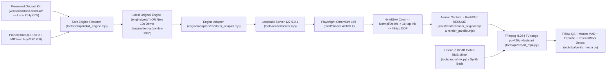

# Architecture & Function-Level Accountability (`SHORT-01`)

## 1. Verified Render Pipeline Call Graph

---

## 2. Function-Level Accountability Table (NEW / Adapter / QA Code)

*(All 14 original kit files & symbols are mapped separately in [SOURCE_AUDIT.md](SOURCE_AUDIT.md).)*

| File & Symbol | Provenance | Arguments | Return / Effect | Frame / Seed Dependency | Side Effects / Disk Writes | Verified By |
| :--- | :---: | :--- | :--- | :--- | :--- | :--- |
| `tools/setup/safe_path.py::resolve_confined` | NEW | `(root, relative_path)` | Confined `Path`; raises `PathSecurityError` on escape | None | None | `test_safe_path_and_disk.py` |
| `tools/setup/safe_path.py::safe_rmtree` | NEW | `(target, allowed_parent)` | Deletes strictly nested dir only | None | Deletes child dir only | `test_safe_path_and_disk.py` |
| `tools/setup/safe_path.py::atomic_write_bytes` | NEW | `(dest, data)` | Temp write + `fsync` + `os.replace` | None | Atomic file write | `test_safe_path_and_disk.py` |
| `tools/setup/safe_path.py::check_disk_space` | NEW | `(path, estimated_bytes, watermark_mb)` | Free-space dict; raises `DiskSpaceError` below reserve | None | Read-only | `test_safe_path_and_disk.py` |
| `tools/setup/audit_kit.py::inspect_zip_archive` | NEW | `(zip_path, limits...)` | CRC32/SHA-256/security audit; rejects traversal, symlinks, duplicates, bombs | Deterministic per ZIP | Read-only | `test_audit_kit.py` |
| `tools/setup/audit_kit.py::safe_extract_and_preserve` | NEW | `(zip_path, project_root, preserve_dir)` | Isolated extract + byte-identical copy + SHA-256 manifest | Deterministic per ZIP | Writes `vendor/cartoon-short-kit/` | `test_audit_kit.py`, `test_original_engine_parity.py` |
| `tools/setup/install_engine.mjs::restoreOriginalEngine` | NEW | `(projectRoot)` | Restores `engine/web/`, pins `three@0.160.0` + `toon.ts` (`e3b817b6`), strips TS (`mode: 'strip'`), builds `toon.js` | Deterministic | Writes `engine/web/`, `vendor/licenses/`, `vendor/upstream-deps-lock.json` | Run `SHORT-01-20261119-02` + `safe_setup.mjs` |
| `tools/setup/safe_setup.mjs::verifyEnvironment` | NEW | `(projectRoot)` | Verifies Node, Three.js, Playwright, Chromium, Python pkgs, FFmpeg/FFprobe, kit files | None | Read-only | `tests/run_all.py` |
| `app/shared/contract.mjs::validateProjectSpec` | NEW | `(spec)` | Enforces 1080×1920 30fps Three.js; rejects 16:9 / Skia / ReachMora / AI-video | None | None | `test_contract_and_adapter.mjs` |
| `tools/render/server.mjs::startLoopbackServer` | NEW | `(mounts, port)` | Loopback `127.0.0.1` HTTP server with raw-path traversal blocking (`403`) | None | Loopback socket | `test_contract_and_adapter.mjs` |
| `tools/render/frame_runner.mjs::validateExistingResumeFrame` | NEW | `(filePath, sha256, w, h)` | Validates PNG/JPEG header dimensions + SHA-256 before RESUME skip | Deterministic | Read-only | `test_contract_and_adapter.mjs`, `test_webgl_and_ffmpeg.py` |
| `engine/adapters/renderer_adapter.mjs::createRendererAdapter` | NEW | `(projectRoot)` | Exposes `initializeRenderer`, `renderFrame`, `renderFrameRange`, `renderStill`, `getRenderMetadata`, `disposeRenderer` | Deterministic per `frameIndex` | Loopback server, Chromium, atomic frames | `test_contract_and_adapter.mjs`, `test_webgl_and_ffmpeg.py` |
| `tools/render/render_original.mjs` / `render_parallel.mjs` | NEW | CLI options | Captures frame specs/ranges with bounded 2-worker sharding, disk preflight, RESUME, repeat determinism check | Deterministic per frame | Writes frames + JSON reports | Soldier 15 stills, Soldier 180f preview, Zombie 300f proof |
| `engine/demos/zombie-10s/*` | NEW | `window.renderFrame(f)` (`0..299`) | Freshly authored Convenience Store + Cartoon Zombie 10s proof (300 frames, 9:16, Three.js + Ink + 48-tap DOF + MIT `Pen`) | Deterministic per `f` & seed | Canvas WebGL output | `test_original_kit_modules.mjs`, `out/new-zombie-10s-preview.mp4` |
| `tools/timing/timing_contract.py` | NEW | `(duration, fps)` / `(segments, duration)` | Validates `round(duration * 30)` and monotonic non-overflowing phrase timings | Deterministic | None | `test_timing_contract.py` |
| `tools/audio/mix.py::mix_linear_gated_rms` | NEW | `(narration, music, sfx, ...)` | SKILL-spec constant-gain `-6.02 dB` (`0.50` ratio) mixer without dynamic ducking + peak caps | Deterministic | Caller writes WAV | `test_audio_mix.py`, `soldier_audio_audit.py` |
| `tools/audio/soldier_audio_audit.py` | NEW | `(preview_out, seconds)` | Runs original `audio.py` (Config A) vs `mix.py` (Config B) in isolated temp dir and measures exact divergence | Deterministic | Optional music+SFX WAV | `test_original_engine_parity.py` |
| `tools/audio/zombie_audio.py` | NEW | `(out_wav)` | Synthesizes 10.00s convenience-store comedy music + SFX bed (no fake voiceover) | Seed `2026` | Writes WAV | `out/new-zombie-10s-preview.mp4` |
| `tools/qa/export_mp4.py::export_frames_to_mp4` | NEW | `(frames_dir, out_mp4, fps, pattern, audio_wav)` | Argument-array FFmpeg H.264 TV-range `yuv420p` `+faststart` optional AAC exporter with atomic rename | Deterministic | Writes MP4 | `test_webgl_and_ffmpeg.py`, Soldier & Zombie MP4s |
| `tools/qa/verify_media.py` | NEW | `(image_path)` / `(mp4_path)` | Pillow decode QA, black/flat detection, sequence motion MAD, FFprobe + FFmpeg null decode + `moov`-first faststart check | Deterministic | Read-only | `test_webgl_and_ffmpeg.py`, Soldier & Zombie QA |
| `tools/qa/contact_sheet.py` | NEW | `(in_dir, out_jpg, cols)` | Atomic 270×480 contact-sheet builder matching original `sheet.py` layout | Deterministic | Writes JPG | `out/reference-contact-sheet.jpg`, `out/new-zombie-contact-sheet.jpg` |
| `app/server/api_server.mjs::startApiServer` | NEW | `({ port, projectRoot })` | Loopback `127.0.0.1` verification API preparing SHORT-02 | None | Loopback socket | `test_contract_and_adapter.mjs` |
