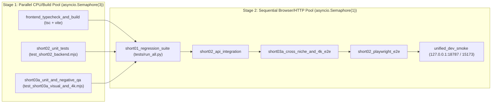

# Verification & Bounded Async DAG Design (`tests/verify_all.py`)

`tests/verify_all.py` orchestrates all build, regression, unit, negative QA, cross-niche, and E2E stages inside a deterministic two-stage bounded DAG so SwiftShader headless Chromium never oversubscribes host memory/CPU:

## Resource & Cleanliness Safeguards
- **Stage 1 max concurrency = 3:** Pure CPU/TypeScript/Vite/unit suites run concurrently with zero headless browser conflicts.
- **Stage 2 max concurrency = 1:** Strictly serializes headless Chromium + FFmpeg sub-runs (`tests/run_all.py`, `api_integration`, `cross_niche_and_4k_e2e`, `studio_e2e`, `unified_dev_smoke`) using isolated loopback `port: 0` servers (or explicit dev smoke ports `18787`/`15173`) and teardown handlers so no Chromium processes or temp project records leak.
- **Native 4K Multi-Shard Acceleration:** Updated `tools/render/render_parallel.mjs` safely scales up to `3` workers on hosts with `>= 4.5 GB` free RAM and `>= 8` CPU cores (`2` default when spacious) instead of hardlocking single-threaded execution.
